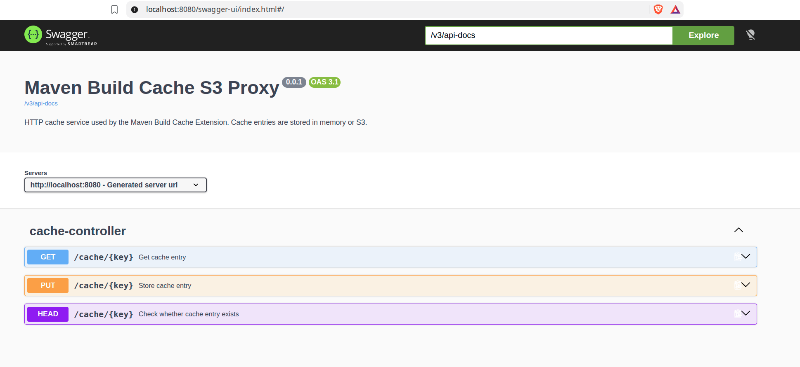

# Architecture

## Responsibilities and request path

The Maven Build Cache Extension calculates cache keys and decides whether a build can reuse an entry. It sends entries to this service over HTTP; the service stores opaque bytes without interpreting Maven build metadata.

`CacheController` maps GET/PUT/HEAD requests to the `CacheStorage` interface (`get`, `put`, `exists`). Spring configuration selects one implementation, so the controller does not depend on S3.

## Storage implementations

| Storage | Selection | Stored state |
| --- | --- | --- |
| `InMemoryCacheStorage` | `cache.storage.type=memory` (default) | Per-process byte arrays; lost when the process stops |
| `S3CacheStorage` | `cache.storage.type=s3` | Objects in an existing bucket; each cache key becomes the object key |

Local runs and controller tests use in-memory storage by default. S3 integration tests use `S3CacheStorage` against LocalStack, which emulates the S3 endpoint; LocalStack is not a separate `CacheStorage` implementation.

To add a backend, implement `CacheStorage` and configure Spring to select it as the active storage bean. Supply its connection settings and any backend health checks separately. The controller and Maven client configuration do not need to change.

## Production storage

For this service's shared binary build artifacts, **Amazon S3 is the preferred production backend**:

* **Direct fit:** complete artifacts map to objects accessed by key through the SDK; no mounted filesystem or database schema is needed.
* **Independent storage:** the retained dataset stays outside the application's memory and disks. Multiple service instances use the same bucket, and entries survive service restarts and replacements.
* **Concurrent CI agents:** S3 commits whole objects atomically and provides strong read-after-write consistency, so another agent cannot read a partially written object. Concurrent writes to one key use last-writer-wins.
* **Capacity and cost:** S3 grows without provisioning storage nodes or volumes or keeping the retained dataset in cache RAM. [Usage-based billing](https://aws.amazon.com/s3/pricing/) can be cost-effective for intermittent CI workloads; storage remains billable while objects are retained, with operation and applicable transfer charges.

Identical uploads to one key preserve the same bytes. Different outputs for one key can overwrite each other; the adapter adds no conditional-write checks or transaction across keys. See [S3 consistency](https://docs.aws.amazon.com/AmazonS3/latest/userguide/Welcome.html#ConsistencyModel).

S3 [Lifecycle rules](https://docs.aws.amazon.com/AmazonS3/latest/userguide/object-lifecycle-mgmt.html) can automatically expire cache objects after a configurable age, for example **30 days**. Configure the rule on the bucket; this application does not set it. Deletion is asynchronous, so this is not an exact deletion deadline. For versioned buckets, also configure expiration of noncurrent versions to remove retained old data.

_Tradeoff_: cache reads and writes require network requests to storage. The current S3 implementation still buffers complete objects in JVM memory, so using S3 does not remove per-request memory requirements.

### Other clouds

The corresponding object storage services are [Azure Blob Storage](https://learn.microsoft.com/en-us/azure/storage/blobs/storage-blobs-introduction) and [Google Cloud Storage](https://cloud.google.com/storage/docs/introduction). A native integration would add a `CacheStorage` adapter, provider-specific authentication/configuration and integration tests; neither is currently included.

## HTTP API

`{key}` is the path after `/cache/` and may contain slashes, for example `com/example/demo/hash/data`. The controller removes the leading slash before calling storage.

| Request | Result |
| --- | --- |
| `PUT /cache/{key}` with a binary body (`Content-Type: application/octet-stream`) | Stores/replaces the bytes; returns `204 No Content` |
| `GET /cache/{key}` | Returns `200 OK` with `application/octet-stream`, or `404 Not Found` for a missing entry |
| `HEAD /cache/{key}` | Returns `200 OK` for an existing entry or `404 Not Found`; no response body |

`GET /cache/hello` is a separate diagnostic route returning the text `hello`; avoid using `hello` as a cache key.

Swagger UI: `http://localhost:8080/swagger-ui/index.html`.

## Current scope

The tests cover storage directly and HTTP handling through MockMvc, but do not run a Maven Build Cache Extension client or verify real network transport. See [test coverage](readme-dev.md#3-run-tests).

The supplied project has no production service image, AWS deployment, application authentication or cache eviction.
